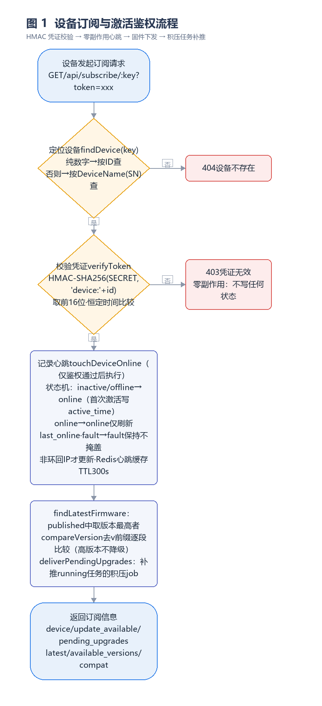
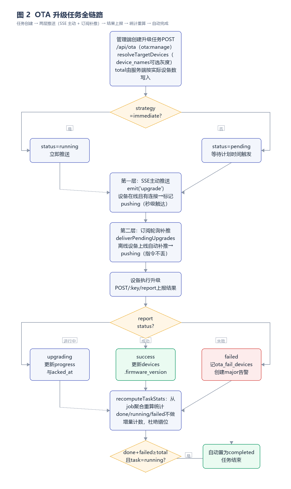
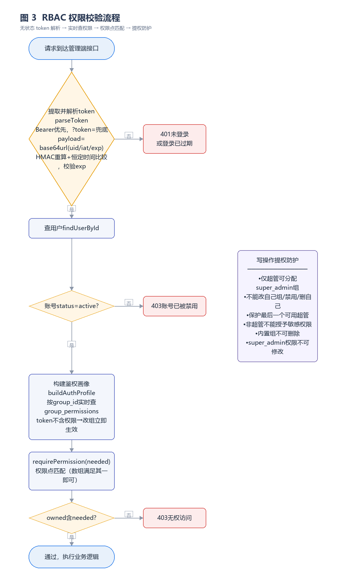

# IoT 设备管理平台技术文档

> 版本：v1.0 ｜ 文档类型：项目交付技术文档 ｜ 密级：内部
> 适用读者：项目验收方、运维团队、后续研发团队

---

## 1. 项目概述

### 1.1 项目背景

随着物联网设备规模的增长，设备固件的版本管理、远程升级（OTA）与运行状态监控成为运维工作的核心痛点。本平台（iot-platform）旨在提供一套轻量、可私有化部署的 IoT 设备管理解决方案，覆盖产品管理、设备档案、固件管理、OTA 升级、告警中心、用户权限与系统配置等完整业务闭环。

### 1.2 建设目标

| 目标 | 说明 |
|------|------|
| 设备全生命周期管理 | 产品 → 设备 → 固件 → 升级 → 告警的一站式管理 |
| 低成本设备接入 | 设备仅需实现一个 HTTP 订阅接口即可完成激活、保活与固件拉取，无需额外注册协议 |
| 可靠的 OTA 升级 | SSE 主动推送 + 订阅轮询补推双层机制，离线设备上线自动续推 |
| 精细化权限控制 | 无状态 token + RBAC 权限点，18 个权限点覆盖全部模块 |
| 多实例可扩展 | 可选接入 Redis，解决多实例 SSE 推送、在线统计与配置共享 |
| 私有化部署 | SQLite 单文件存储 + Node.js 运行时，一键启停脚本 |

### 1.3 术语约定

| 术语 | 说明 |
|------|------|
| DeviceName (SN) | 设备唯一序列号，设备固件中通常写死，作为订阅凭据的一部分 |
| 订阅 token | 设备侧访问凭证，由 HMAC-SHA256 派生，与管理端会话 token 相互独立 |
| 权限点 | 形如 `模块:动作` 的权限标识（如 `device:edit`），前后端共用同一份定义 |
| job | 设备级升级子任务，一条 OTA 任务按目标设备拆分为多个 job |
| SSE | Server-Sent Events，HTTP 长连接服务端推送技术 |

### 1.4 技术栈总览

**前端**（根目录工程，端口 5173）：

| 依赖 | 版本 | 用途 |
|------|------|------|
| Vue | ^3.4.0 | 前端框架（Composition API） |
| vue-router | ^4.3.0 | 路由 |
| element-plus | ^2.9.0 | UI 组件库（按需引入） |
| echarts / vue-echarts | ^5.5.0 / ^7.0.0 | 图表（异步懒加载） |
| vite | ^5.4.0 | 构建工具（gzip + brotli 预压缩） |

**后端**（`server/` 目录，端口 3000，全程 ES Modules）：

| 依赖 | 版本 | 用途 |
|------|------|------|
| express | ^4.21.0 | HTTP 框架 |
| better-sqlite3 | ^11.0.0 | SQLite 驱动（同步 API，WAL 模式） |
| redis | ^4.7.1 | Redis 客户端（可选，优雅降级） |
| multer | ^1.4.5-lts.1 | 固件文件上传 |
| crypto（Node 内置） | — | HMAC 签名、PBKDF2 口令哈希 |

---

## 2. 总体架构设计

### 2.1 系统分层架构

系统采用前后端分离的单仓库结构，后端内部按「路由层 → 服务层 → 数据层」三层组织：

```
┌────────────────────────────────────────────────┐
│  浏览器 / 设备端                                  │
│  ┌──────────────┐      ┌────────────────────┐  │
│  │ 管理端 SPA    │      │ 设备固件 (HTTP)     │  │
│  │ Vue 3 + EP   │      │ 订阅/下载/上报/SSE  │  │
│  └──────┬───────┘      └─────────┬──────────┘  │
└─────────┼────────────────────────┼─────────────┘
          │ /api (Bearer token)    │ /api/subscribe (HMAC token)
┌─────────▼────────────────────────▼─────────────┐
│  Express 4 (server/index.js)                    │
│  cors → json → apiLogger 中间件                  │
│  ┌──────────────────────────────────────────┐  │
│  │ routes/   管理端业务路由（14 组）           │  │
│  │ subscribe.js 设备侧路由（独立鉴权）          │  │
│  └──────────────────────────────────────────┘  │
│  ┌──────────────────────────────────────────┐  │
│  │ services/ auth · push(SSE) · redis ·      │  │
│  │           config-store · api-logger ·     │  │
│  │           device-monitor                  │  │
│  └──────────────────────────────────────────┘  │
│  ┌──────────────────────────────────────────┐  │
│  │ db/  index-core(SQLite 单例 WAL)           │  │
│  │      init(建表+种子)  auth-schema(权限)     │  │
│  └──────────────────────────────────────────┘  │
└──────────┬───────────────────────┬──────────────┘
     SQLite (iot.db)        Redis (可选，降级可用)
     uploads/firmware/      固件文件存储
```

### 2.2 后端目录职责

```
server/
├── index.js            # 入口：config-store 必须第一个 import
├── config.json         # 运行时配置（config-store 管理）
├── db/
│   ├── index-core.js   # DB 单例（WAL + 外键约束），避免循环 import
│   ├── init.js         # 建表 + 业务种子数据 + 固件占位文件
│   └── auth-schema.js  # 权限点定义 + 内置组/用户种子 + PBKDF2
├── services/
│   ├── auth.js         # token 签发/校验 + 中间件三件套 + RBAC 查询
│   ├── config-store.js # config.json 持久化 + process.env 同步 + 脱敏
│   ├── redis.js        # 双连接 + 优雅降级 + 重连升格
│   ├── push.js         # SSE 连接表 + Redis Pub/Sub 多实例推送
│   ├── api-logger.js   # API 调用日志（SQLite 明细 + Redis 计数）
│   └── device-monitor.js # 心跳超时扫描（60s 定时 + Redis 分布式锁）
└── routes/
    ├── auth.js / users.js / groups.js     # 会话与权限管理
    ├── dashboard.js / devices.js / product.js  # 业务查询
    ├── firmware.js / ota.js / alert.js    # 固件与升级
    ├── subscribe.js                       # 设备侧（独立 HMAC 鉴权）
    ├── stats.js / system.js               # 统计与系统配置
    └── ...                                # 共 14 组路由
```

### 2.3 启动流程与关键约定

**一键启动**（`npm start` → `scripts/start.mjs`）五步流程：

1. **依赖检查**：检测前端 `vite`、后端 `better-sqlite3` 是否就位，缺失自动 `npm install`；
2. **Node 运行时探测**：`better-sqlite3` 原生绑定与 Node ABI 强相关，启动脚本会自动找到能加载该绑定的 Node 可执行文件（支持 `IOT_NODE` 环境变量显式指定）；
3. **端口清理**：后端 3000 / 前端 5173 被占用时自动结束占用进程（`--no-kill` 可改为仅提示）；
4. **并行启动**：后端 `node index.js`，前端 `vite --port 5173 --strictPort`，并注入 `VITE_PROXY_TARGET`；
5. **健康检查**：轮询 `GET /api/health` 与前端首页，就绪后输出访问地址。

**后端启动顺序**（`server/index.js`）：

```
1. import './services/config-store.js'   ← 必须第一个 import
2. import 各业务路由模块（模块级常量此时固化 process.env 值）
3. import api-logger / device-monitor（定时任务随模块加载启动）
4. 创建 Express app，挂载 cors / json / apiLogger
5. 注册 14 组路由（含 /api/health）
6. app.listen(PORT, '0.0.0.0')
```

> **关键约定**：`config-store.js` 必须最先加载。它负责把 `server/config.json` 的配置同步进 `process.env`（不覆盖 shell 已有环境变量），而 `auth.js` 的 `AUTH_SECRET`、`subscribe.js` 的 `SUBSCRIBE_SECRET` 等都是模块级常量，在 import 时即固化。若 config-store 晚于这些模块加载，配置将退回硬编码默认值。

### 2.4 响应协议约定

| 端 | 协议 | 说明 |
|----|------|------|
| 管理端接口 | HTTP 200 + `{ code, message, data }` | `code === 0` 表示成功，业务错误码放 body 内 |
| 设备侧接口 | 真实 HTTP 状态码（200/403/404） | **有意例外**：便于嵌入式端按状态码处理，前端 request.js 同样兼容 |

---

## 3. 数据库设计

### 3.1 存储选型与连接管理

- **SQLite 单文件**（`server/db/iot.db`）：零运维、私有化部署友好；`better-sqlite3` 同步 API 与 Express 的请求模型天然契合；
- **WAL 模式**：`journal_mode = WAL` 提升并发读性能；开启 `foreign_keys = ON` 强制外键约束；
- **单例连接**（`db/index-core.js`）：`init.js`（业务建表）与 `auth-schema.js`(权限种子) 共享同一 Database 实例，避免循环 import 时拿到未初始化的连接。

### 3.2 表结构总览（13 张表 + 4 索引）

| 表 | 用途 | 关键字段 |
|----|------|---------|
| products | 产品 | key(唯一)、node_type、net_type、冗余统计字段 |
| firmwares | 固件 | version、status(draft/published/deprecated)、md5、sign_algo |
| firmware_compat | 固件兼容性 | model、min_version、max_version（级联删除） |
| devices | 设备 | device_name(SN,唯一)、status、firmware_version、active_time、last_online |
| device_props | 设备属性 | device_id(级联删除)、prop_name、prop_value |
| ota_tasks | OTA 任务 | strategy、total/done/running/failed、status(5 态) |
| ota_fail_devices | 升级失败记录 | task_id(级联删除)、device_name、reason（去重） |
| alerts | 告警 | level(4 级)、status(3 态)、device_name |
| device_upgrade_jobs | 设备级升级 job | task_id、device_id、status(5 态)、progress、pushed_at/acked_at/completed_at |
| user_groups | 用户组 | name/code(唯一)、is_system(内置组标记) |
| group_permissions | 组权限关联 | group_id + permission 唯一约束（级联删除） |
| users | 用户 | password_hash + salt（PBKDF2）、group_id、status |
| api_call_logs | API 调用日志 | method/path/route/status/duration/ip/client |

核心索引：

```sql
CREATE INDEX idx_duj_task   ON device_upgrade_jobs(task_id);
CREATE INDEX idx_duj_device ON device_upgrade_jobs(device_id, status);
CREATE INDEX idx_users_group ON users(group_id);
-- api_call_logs 另有 created_at / route / duration DESC 三个索引
```

### 3.3 关键设计说明

**（1）设备表的时间语义**

| 字段 | 写入时机 | 语义 |
|------|---------|------|
| active_time | 仅首次激活（inactive → online）时写入，此后不变 | 设备生命周期内的激活时刻 |
| last_online | 每次成功订阅都刷新 | 最近一次上线时间 |
| ip | 仅请求来源为非环回地址时更新 | 避免本机调试冲掉真实 IP |
| status | 由订阅状态机维护（见 4.1 节） | online/offline/inactive/fault |

时间格式统一为 `YYYY-MM-DD HH:mm:ss` 本地时间，与 SQLite `datetime('now','localtime')` 完全一致，前端可直接展示。

**（2）OTA 任务与 job 的两级结构**

`ota_tasks` 是任务级聚合（total/done/running/failed 为冗余统计，由 job 聚合重算），`device_upgrade_jobs` 是设备级明细。按目标设备逐台拆分 job，使升级进度、失败原因、重推操作都能精确到单台设备。

**（3）冗余字段策略**

products 表的 `device_count`、`firmware_count`、`online_rate`，firmwares 表的升级统计等均为读优化冗余字段，在业务变更时同步维护，避免列表页频繁聚合查询。

### 3.4 权限体系数据模型

**18 个权限点**（`模块:动作` 命名，前后端共用同一份定义）：

| 分组 | 权限点 |
|------|--------|
| 基础 | dashboard:view |
| 设备 | device:view / device:edit / device:delete |
| 固件 | firmware:view / firmware:manage |
| 升级 | ota:view / ota:manage |
| 产品 | product:view / product:manage |
| 告警 | alert:view / alert:handle |
| 监控 | stats:view |
| 系统 | system:manage / user:view / user:manage / group:view / group:manage |

**三个内置用户组**（`is_system = 1`，权限不可删除）：

| 组 | code | 权限范围 |
|----|------|---------|
| 超级管理员 | super_admin | 全部 18 项（权限不可修改） |
| 运维管理员 | ops_admin | 13 项业务权限，不含 stats:view 之外的用户组/系统配置管理 |
| 只读访客 | viewer | 各模块 view 权限，无任何修改与统计权限 |

**种子用户**：admin（super_admin）、ops（ops_admin）、viewer（viewer），口令均为 PBKDF2 加盐哈希存储。

### 3.5 种子数据

系统首次启动自动写入演示数据：4 个产品、6 个固件（覆盖三种状态）、7 条兼容性记录、7 台设备（online/offline/inactive 三态）、5 个 OTA 任务（覆盖全部 5 种状态）、4 条失败记录、8 条告警（4 级 × 3 处理状态）。删除 `iot.db` 后重启即可重置。此外为 `file_path` 为空的固件自动生成 `demo-<id>.bin` 占位文件，保证固件下载链路可端到端验证。

---

## 4. 核心算法与关键流程

本章为文档核心，描述系统三个最具代表性的算法设计。配套流程图见 docs/tech-doc/ 目录下 flow1-subscribe.png（图 1）、flow2-ota.png（图 2）、flow3-rbac.png（图 3）。

### 4.1 算法一：设备订阅与激活鉴权



#### 4.1.1 设计思想

设备端算力与存储有限，无法承载复杂的会话机制。本平台将「设备注册、激活、保活、固件发现」四个职责合并到一个 HTTP 订阅接口中：**一次鉴权成功的订阅请求 = 一次设备在线心跳**。设备固件只需周期性 GET 一个 URL 即可完成全部接入动作，无需实现任何额外的注册协议。

#### 4.1.2 订阅凭证算法（HMAC Token）

```js
// server/routes/subscribe.js
function buildToken(deviceId) {
  return crypto
    .createHmac('sha256', SUBSCRIBE_SECRET)
    .update(`device:${deviceId}`)
    .digest('hex')
    .slice(0, 16);          // 取前 16 位十六进制
}

function safeEqual(a, b) {  // 恒定时间比较，防时序侧信道
  const bufA = Buffer.from(String(a ?? ''));
  const bufB = Buffer.from(String(b ?? ''));
  if (bufA.length !== bufB.length) return false;
  return crypto.timingSafeEqual(bufA, bufB);
}
```

设计要点：

| 要点 | 说明 |
|------|------|
| 派生式凭证 | `HMAC-SHA256(SUBSCRIBE_SECRET, 'device:' + deviceId)` 前 16 位，服务端无需存储任何设备 token，泄露风险面为零 |
| 防枚举 | 即使攻击者知道设备 SN，没有 SUBSCRIBE_SECRET 也无法构造有效 token |
| 恒定时间比较 | `crypto.timingSafeEqual` 防止逐字节比对造成的时序侧信道泄露 |
| 独立密钥 | `SUBSCRIBE_SECRET` 与管理端 `AUTH_SECRET` 完全隔离，可独立轮换 |

#### 4.1.3 :key 寻址与鉴权次序（零副作用保证）

```
GET /api/subscribe/:key?token=xxx
  ① findDevice(key)     纯数字 → 先按 id 查、device_name 兜底；非数字 → 按 SN 查；未命中 → 404
  ② verifyToken(req, device)   失败 → 403
  ③ touchDeviceOnline(device, ip)   ← 仅在鉴权通过后执行（心跳副作用）
  ④ 组装订阅响应（固件信息 + 补推任务）
```

> **关键约束**：`touchDeviceOnline` 必须放在 token 校验之后——无效凭证不得产生任何状态变更（不激活、不刷新在线时间）。403/404 响应是纯只读操作，杜绝了伪造请求污染设备状态的可能。

#### 4.1.4 设备状态机

```
inactive（未激活）──首次订阅──▶ online（写 active_time）
offline （离线）  ──订阅─────▶ online（重新上线）
online  （在线）  ──订阅─────▶ online（仅刷新 last_online）
fault   （故障）  ──订阅─────▶ fault （保持，不掩盖故障）
```

实现（`touchDeviceOnline`，subscribe.js）：

```js
const ACTIVATABLE_STATUS = new Set(['inactive', 'offline']);
const activated = statusBefore === 'inactive';
const recovered = statusBefore === 'offline';
const status = ACTIVATABLE_STATUS.has(statusBefore) ? 'online' : statusBefore;
```

**fault → fault 是有意设计**：设备处于故障态时，即使订阅心跳正常也不自动恢复为 online，故障必须由人工处理告警后消除，避免心跳掩盖真实故障。

**时间语义**（与 3.3 节呼应）：

- `active_time` 仅在 `!device.active_time && activated` 时写入，代表设备生命周期内的激活时刻，之后永不变化；
- `last_online` 每次成功订阅都刷新；
- `ip` 仅在非环回来源时更新（`isLoopback` 判断，含 `::ffff:` IPv6 映射前缀剥离）；
- 心跳同时 fire-and-forget 写入 Redis（`redis.touchHeartbeat`，TTL 300s），多实例下在线统计从 O(N) 数据库 COUNT 降为 O(1) HLEN。

#### 4.1.5 固件版本比较算法

```js
function normalizeVersion(version) {   // 'v2.1.0' → [2,1,0]
  return String(version || '').trim()
    .replace(/^[vV]/, '')
    .split('.')
    .map((seg) => { const n = parseInt(seg, 10); return Number.isNaN(n) ? 0 : n; });
}
function compareVersion(a, b) {        // 逐段数字比较，缺失段按 0
  const va = normalizeVersion(a), vb = normalizeVersion(b);
  const len = Math.max(va.length, vb.length);
  for (let i = 0; i < len; i++) {
    const x = va[i] || 0, y = vb[i] || 0;
    if (x > y) return 1;
    if (x < y) return -1;
  }
  return 0;
}
```

自实现而不依赖 semver 库的原因：嵌入式固件版本号不规范（v 前缀、缺段、非数字段），宽松归一化比严格 semver 更贴合实际。服务端仅对 `status='published'` 的固件取版本最高者下发；设备携带 `current_version`（或不传则取设备档案版本）时，服务端计算 `update_available`；**设备版本更高时不降级**。

#### 4.1.6 对外地址推断

```
query.base → SUBSCRIBE_BASE_URL 环境变量 → 请求头 Host 推断
```

同一份代码在局域网直连、内网穿透、Nginx 反代下都能生成正确的 `download_url` / `direct_url`，无需为每个部署环境硬编码地址。

### 4.2 算法二：OTA 升级任务全链路



#### 4.2.1 任务创建与 job 拆分

```
POST /api/ota（需 ota:manage 权限）
  ① resolveTargetDevices(product_name, device_names)   device_names 可选 → 灰度/指定设备
  ② total = targetDevices.length（服务端写，忽略前端传入值，防数据失真）
  ③ 事务内：INSERT ota_tasks + 逐设备 INSERT device_upgrade_jobs(status='pending')
  ④ strategy === 'immediate' → 任务置 running，立即向在线设备推送
```

**total 由服务端按实际设备数写入**是防篡改设计：即使前端伪造 total，任务进度统计仍以真实目标设备数为准。

#### 4.2.2 两层互补推送机制（核心设计）

设备在线状态不可靠，单层推送必然漏推。本平台用两层机制互补覆盖：

**第一层：SSE 主动推送（在线设备即时触达）**

```js
// services/push.js —— 进程内连接表 + Redis Pub/Sub 多实例广播
const clients = new Map();                      // deviceId → SSE 响应集合
const INSTANCE_ID = `${process.pid}-${Date.now()}`;

export function emit(deviceId, event, data) {
  const localDelivered = deliverLocal(deviceId, event, data);  // 本实例立即推
  if (redis.isReady()) {
    redis.publish(SSE_CHANNEL, { sourceId: INSTANCE_ID, deviceId, event, data });
  }                                             // 广播给其他实例
  return localDelivered;
}
```

- 任务创建后对每个 pending job 调用 `pushJob()`：设备离线或无 SSE 连接 → 跳过（留给第二层）；在线且有连接 → `emit('upgrade')` 并标记 job 为 `pushing`；
- 多实例部署时，SSE 连接分散在不同进程，Redis Pub/Sub（`sse:device` 频道）将推送事件广播到所有实例，各实例只推自己持有的连接；`INSTANCE_ID` 去重防止自己推两遍；
- **无 Redis 时全功能降级**为单实例本地广播，不阻塞启动。

**第二层：订阅轮询补推（离线设备上线续推）**

```js
// routes/subscribe.js —— 设备每次订阅都检查积压任务
function deliverPendingUpgrades(device, baseUrl) {
  const jobs = db.prepare(`
    SELECT j.* FROM device_upgrade_jobs j
    JOIN ota_tasks t ON j.task_id = t.id
    WHERE j.device_id = ? AND j.status IN ('pending','pushing')
      AND t.status = 'running'`).all(device.id);
  // 标记 pushing + 构造升级指令加入响应 pending_upgrades 字段
}
```

设备每次 GET 订阅（以及每次建立 SSE 连接时）都会捎带积压的升级指令。**paused/cancelled 任务的 job 不下发**（`t.status='running'` 过滤），保证暂停/取消操作即时生效。

两层机制的关系：SSE 解决「在线设备秒级触达」，订阅补推解决「离线设备上线补齐」——任意一层单独失效都不会造成升级指令永久丢失。

#### 4.2.3 job 状态机与结果上报

```
pending（待推送）→ pushing（已下发）→ upgrading（升级中）→ success / failed
```

`POST /api/subscribe/:key/report`（设备侧，订阅 token 鉴权）按上报状态处理：

| 上报 status | 服务端动作 |
|------------|-----------|
| upgrading | 更新 job.progress（钳位 0-100）与 acked_at |
| success | job 置 success、progress=100；**同步更新 devices.firmware_version 为目标版本** |
| failed | job 置 failed；记录 ota_fail_devices（**按 task_id+device_name 去重**，防止重复上报刷屏）；**自动创建 major 级告警**（unhandled 状态，便于运维跟进） |

#### 4.2.4 任务统计重算算法

```js
function recomputeTaskStats(taskId) {
  const stats = db.prepare(`SELECT
      SUM(CASE WHEN status='success'   THEN 1 ELSE 0 END) as done,
      SUM(CASE WHEN status='upgrading' THEN 1 ELSE 0 END) as running,
      SUM(CASE WHEN status='failed'    THEN 1 ELSE 0 END) as failed,
      COUNT(*) as total
    FROM device_upgrade_jobs WHERE task_id = ?`).get(taskId);
  const allDone = stats.total > 0 && stats.done + stats.failed >= stats.total;
  if (allDone && task.status === 'running') {
    // 全部终结且任务在 running → 自动置 completed
  }
}
```

设计要点：done/running/failed 不做增量计数，而是**每次从 job 表聚合重算**，彻底避免增量更新错位；`done + failed >= total` 且任务处于 running 时自动完成——以「成功 + 失败」双路径收口，不会因个别设备长期无响应而永久挂起任务。

#### 4.2.5 管理端干预能力

| 接口 | 能力 |
|------|------|
| `POST /ota/:id/pause` / `resume` / `cancel` | 暂停/恢复/取消任务；非 running 状态的 job 一律不下发 |
| `POST /ota/:id/push?reset_failed=1` | 重新推送；`reset_failed=1` 先把 failed job 重置为 pending（清空 error/progress）再推 |

### 4.3 算法三：RBAC 权限校验



#### 4.3.1 无状态 Token 签发与校验

```js
// services/auth.js
const SECRET = process.env.AUTH_SECRET;
const TTL = Number(process.env.AUTH_TOKEN_TTL || 7 * 24 * 3600);  // 默认 7 天

export function issueToken(userId) {
  const now = Math.floor(Date.now() / 1000);
  const payload = Buffer.from(
    JSON.stringify({ uid: userId, iat: now, exp: now + TTL })
  ).toString('base64url');
  return `${payload}.${sign(payload)}`;   // base64url(payload).HMAC(payload)
}

export function parseToken(token) {
  // ① HMAC 重算 + timingSafeEqual 恒定时间比较签名
  // ② base64url 解码 → JSON.parse
  // ③ 校验 uid 存在、exp 未过期
}
```

- **不落库**：token 无会话表，水平扩展无需共享会话存储；
- 携带方式：`Authorization: Bearer <token>` 优先，`?token=` 兜底（EventSource 等无法自定义请求头的场景）；
- 401（未登录/token 无效）与 403（账号禁用/无权限）严格区分。

#### 4.3.2 实时权限查询（token 不含权限）

```js
export function getGroupPermissions(groupId) {
  return db.prepare('SELECT permission FROM group_permissions WHERE group_id = ?')
    .all(groupId).map((r) => r.permission);
}
export function buildAuthProfile(user) {
  return { ...user_fields, permissions: getGroupPermissions(user.group_id) };
}
```

**token 载荷只有 `{ uid, iat, exp }`，不含任何权限信息**。每次请求都按用户的 `group_id` 实时查库构建权限画像。取舍：多一次轻量查询（SQLite 本地读，微秒级），换来「修改用户组权限立即生效」——无需踢会话、无需等 token 过期。

#### 4.3.3 中间件三件套

| 中间件 | 职责 | 失败响应 |
|--------|------|---------|
| `authenticate` | 必须登录；解析 token → 查用户 → 挂载 `req.user`（含 permissions） | 401（token 问题）/ 403（账号禁用） |
| `optionalAuth` | 有合法 token 则挂载用户，否则静默放行 | 永不失败 |
| `requirePermission(needed)` | 权限点校验；数组时满足其一即可（or 语义） | 401（未登录）/ 403（明确列出所需权限） |

#### 4.3.4 提权防护矩阵（写操作额外校验）

| 防护规则 | 实现位置 |
|---------|---------|
| 仅超管可分配 super_admin 组 | users.js `canAssignGroup` |
| 不能修改自己的用户组 / 禁用自己 / 删除自己 | users.js（防自锁） |
| 保护最后一个可用超管（删除/禁用前检查剩余可用超管数） | users.js `activeSuperAdminCount` |
| 非超管不能修改超管资料 | users.js |
| 非超管不能授予 user:manage / group:manage | groups.js `validatePermissions` |
| 内置组（is_system）不可删除；super_admin 组权限不可修改；有成员的组不可删除 | groups.js |

**前端权限判断仅为展示级优化（菜单显隐、按钮置灰），安全边界完全在后端 `requirePermission`。** 前端路由 `meta.perm` 与后端共用同一份权限点定义（`db/auth-schema.js` 的 PERMISSIONS），新增权限点后 `migratePermissions()` 在启动时为内置组补齐（INSERT OR IGNORE，只加不删）。

#### 4.3.5 口令安全

```js
export function hashPassword(password, salt = crypto.randomBytes(16).toString('hex')) {
  const hash = crypto.pbkdf2Sync(String(password), salt, 120000, 32, 'sha256').toString('hex');
  return { hash, salt };
}
```

| 措施 | 参数 |
|------|------|
| PBKDF2-HMAC-SHA256 | 12 万次迭代、32 字节输出、每用户独立 16 字节随机盐 |
| 恒定时间比较 | `timingSafeEqual` 防时序侧信道 |
| 防用户枚举 | 登录失败统一文案「用户名或密码错误」 |
| 密码强度 | 6-32 位，字母/数字/符号至少含两种 |

---

## 5. 接口设计

### 5.1 管理端接口（会话 token + RBAC）

统一响应协议：HTTP 200 + `{ code, message, data }`，`code === 0` 为成功。

| 模块 | 接口 | 方法 | 权限点 | 说明 |
|------|------|------|--------|------|
| 会话 | /api/auth/login | POST | 公开 | 登录，签发 token |
| | /api/auth/register | POST | 公开 | 注册（AUTH_ALLOW_REGISTER 控制） |
| | /api/auth/me | GET | 登录 | 当前用户画像（含 permissions） |
| | /api/auth/password | PUT | 登录 | 修改密码 |
| | /api/auth/permissions | GET | 登录 | 权限点字典 |
| 用户 | /api/users | GET/POST | user:view / user:manage | 列表 / 创建 |
| | /api/users/:id | PUT/DELETE | user:manage | 修改 / 删除（含提权防护） |
| 用户组 | /api/groups | GET/POST | group:view / group:manage | 列表 / 创建 |
| | /api/groups/:id/permissions | PUT | group:manage | 覆盖式写权限 |
| 设备 | /api/devices | GET/POST | device:view / device:edit | 列表 / 创建 |
| | /api/devices/stats | GET | device:view | 统计（须定义在 /:id 之前） |
| | /api/devices/:id | PUT/DELETE | device:edit / device:delete | 修改 / 删除（支持逗号分隔批量） |
| 固件 | /api/firmwares | GET/POST | firmware:view / firmware:manage | 列表 / 上传 |
| | /api/firmwares/:id/publish | POST | firmware:manage | 发布 |
| OTA | /api/ota | GET/POST | ota:view / ota:manage | 列表 / 创建任务 |
| | /api/ota/:id/jobs | GET | ota:view | 设备级升级明细 |
| | /api/ota/:id/push | POST | ota:manage | 重新推送（?reset_failed=1） |
| | /api/ota/:id/pause·resume·cancel | POST | ota:manage | 任务干预 |
| 告警 | /api/alerts | GET | alert:view | 列表（分页+筛选） |
| | /api/alerts/:id/handle | POST | alert:handle | 处理告警 |
| 统计 | /api/stats/overview | GET | stats:view | API 调用统计（Redis 优先 O(1)，降级 SQLite） |
| 系统 | /api/system/footer | GET | **公开** | 页脚（登录页也展示，注册在 authenticate 之前） |
| | /api/system/config | GET/PUT | system:manage | 配置读取（脱敏）/ 修改 |
| | /api/system/info | GET | system:manage | 运行信息（Node/内存/Redis 状态） |
| | /api/system/scan-offline | POST | system:manage | 手动触发离线扫描 |

### 5.2 设备侧接口（订阅 token，真实 HTTP 状态码）

| 接口 | 方法 | 鉴权 | 说明 |
|------|------|------|------|
| /api/subscribe/:key | GET | 订阅 token | 订阅固件信息 + 心跳 + 补推（核心接口） |
| /api/subscribe/:key/events | GET | 订阅 token | SSE 长连接（hello/upgrade 事件，25s 心跳注释保活） |
| /api/subscribe/:key/report | POST | 订阅 token | 上报升级结果（upgrading/success/failed） |
| /api/subscribe/:key/download | GET | 订阅 token | 带鉴权固件下载（可统计、隐藏真实路径） |
| /api/subscribe/:key/link | GET | 管理端 device:view | 生成订阅链接（管理端专用） |

`:key` 支持设备 ID 或 DeviceName(SN)；`?token=` 为订阅凭证。订阅响应核心字段：

```json
{
  "code": 0,
  "data": {
    "device": { "status": "online", "activated": true, "active_time": "...", "last_online": "..." },
    "update_available": true,
    "pending_upgrades": [ { "task_id": "...", "target_version": "v2.1.0", "firmware": {...} } ],
    "latest": { "version": "v2.1.0", "md5": "...", "download_url": "...", "direct_url": "..." },
    "available_versions": [ ... ],
    "compat": [ { "model": "...", "min_version": "...", "max_version": "..." } ]
  }
}
```

固件下载地址有两条路径：`download_url`（带 token 鉴权，推荐，可统计可隐藏路径）与 `direct_url`（静态直链 /uploads/firmware/*）。

---

## 6. 安全设计

### 6.1 双轨鉴权体系

| 维度 | 管理端 | 设备侧 |
|------|--------|--------|
| 凭证 | 无状态会话 token（uid/iat/exp） | HMAC 派生 token（确定性，可重算） |
| 密钥 | AUTH_SECRET | SUBSCRIBE_SECRET（独立，可单独轮换） |
| 有效期 | 默认 7 天（AUTH_TOKEN_TTL） | 长期有效（随密钥轮换失效） |
| 状态码 | HTTP 200 + 业务 code | 真实 HTTP 状态码（403/404） |

两套体系完全隔离：设备 token 绝不能访问管理端接口，管理端会话也不能订阅设备接口。

### 6.2 密码与凭证安全

- **PBKDF2-HMAC-SHA256，12 万次迭代**，每用户独立 16 字节随机盐（详见 4.3.5）；
- 全部签名/口令比较使用 `crypto.timingSafeEqual` **恒定时间比较**；
- 登录失败统一文案，防用户名枚举；`AUTH_ALLOW_REGISTER` 可关闭自助注册。

### 6.3 输入与配置安全

- OTA 任务 total 服务端写、job progress 钮位 0-100、失败原因截断 500 字符；
- 系统配置 GET 对敏感项（含 SECRET）脱敏为 `••••••`，PUT 空值/脱敏占位符视为不修改；
- 配置 PUT 多层校验：端口 1-65535、TTL ≥ 60s、离线阈值 ≥ 60s、布尔归一化；
- config-store 只允许修改 DEFAULTS 中已声明的 key，白名单防注入未知配置。

### 6.4 提权防护

详见 4.3.4 提权防护矩阵。核心原则：**任何可能导致权限提升或系统失管的写操作都有显式防护**，包括防自锁（不能改自己组/删自己/禁用自己）与防失管（保护最后一个可用超管）。

---

## 7. Redis 接入与多实例扩展

### 7.1 设计原则：可选 + 全降级

Redis 是**可选组件**：连接失败时 `ready=false`，所有封装方法返回安全降级值，系统以单实例模式完整运行，不阻塞启动。连接每 10 秒健康检查，恢复后自动「升格」回 Redis 模式并重新订阅频道。

**双连接架构**：`client`（命令连接）+ `subscriber`（订阅连接，Redis 协议要求 subscribe 期间连接不可作他用）。

### 7.2 五个使用场景

| 场景 | 实现 | 降级行为 |
|------|------|---------|
| SSE 多实例推送 | PUBLISH `sse:device` 频道，INSTANCE_ID 去重 | 本地广播（单实例等价） |
| 设备在线缓存 | HSET heartbeat + TTL 300s，在线数 O(1) HLEN | DB COUNT（O(N)） |
| API 调用计数 | INCR total/today/errors + HINCRBY routes/methods | SQLite 聚合查询 |
| 配置多实例共享 | HSET config 副本 | 仅本地 config.json |
| 分布式锁 | SETNX lock:device:offline-scan | 直接执行扫描 |

### 7.3 何时需要 Redis

单实例部署（绝大多数场景）**无需 Redis**。满足以下任一条件时建议接入：

1. 后端部署多实例做负载均衡（SSE 推送与在线统计必须）；
2. 设备量大，在线数统计频次高（避免每次 COUNT）；
3. API 调用 QPS 高，SQLite 明细表聚合成为瓶颈。

---

## 8. 前端架构与性能优化

### 8.1 分层约定

```
views/          页面组件（11 个视图，meta.perm 声明权限）
components/     通用展示组件（PageHeader / StatCards）
composables/    usePagination（事件驱动分页）· useAsyncData / useAction
utils/          request(fetch 封装+401处理) · api(接口聚合) · auth(会话单例)
                dialog(统一确认弹窗) · element(组件级引入) · performance(防抖节流)
plugins/        echarts 异步懒加载
constants/      状态字典（label + el-tag type），dictValue 安全取值
```

关键约定：

- 导入统一 `@/` 别名；**字段命名直接沿用后端 snake_case**，不建映射层；
- 状态映射统一放 `src/constants/index.js`，key 与后端枚举完全一致；
- `usePagination` 事件驱动（`@current-change`/`@size-change`）而非 watch 页码，避免筛选重置页码与分页变化双重触发重复请求；
- 确认弹窗统一 `utils/dialog.js` 的 `confirm()`（返回 boolean，显式中文按钮——按需引入模式下 ElMessageBox 拿不到全局 locale）；
- `utils/auth.js` 会话 reactive 单例，token/user 持久化 localStorage；`request.js` 自动注入 Bearer、401 自动清会话跳登录。

### 8.2 构建性能优化（实测结论）

| 优化项 | 做法 | 效果/教训 |
|--------|------|----------|
| Element Plus 按需引入 | unplugin-vue-components 自动解析 + ElementPlusResolver | 避免全量安装器进产物 |
| 禁止从根入口引入反馈类组件 | ElMessage/ElMessageBox 走 utils/element.js 组件级路径 | 根入口 export default 会实例化全量安装器，tree-shaking 失效（实测约 +910 kB） |
| 禁用 manualChunks | 交给 Rollup 按动态导入自动分包 | 手动拆 vendor 实测 +400 kB（1606→1207 kB 反向优化） |
| ECharts 异步懒加载 | defineAsyncComponent 包裹 + 独立 setup 文件静态 import | 图表库（约 400 kB）独立 chunk，首屏不加载 |
| 预压缩 | vite-plugin-compression 生成 .gz + .br（threshold 10KB） | Nginx 直接发静态预压缩文件 |
| 兼容目标 | build.target='es2018'，drop console/debugger | 只兼容现代浏览器，减少 polyfill |

> **踩坑记录**：ECharts 按需注册必须用独立 setup 文件的**静态 import**（`echarts/core` + `echarts/charts` + `echarts/components` + `echarts/renderers`）。对聚合入口做动态 import 会因 Vite 预构建丢失命名导出，导致 `undefined.install` 运行时错误；CanvasRenderer 在 `echarts/renderers` 而非 `echarts/charts`。

---

## 9. 部署与运维

### 9.1 环境变量清单

| 变量 | 默认值 | 需重启 | 说明 |
|------|--------|--------|------|
| AUTH_SECRET | iot-platform-auth-secret-change-me | 是 | **生产必须覆盖**，token 签名密钥 |
| AUTH_TOKEN_TTL | 604800 | 是 | 会话有效期（秒） |
| AUTH_ALLOW_REGISTER | true | 是 | 是否开放注册 |
| AUTH_DEFAULT_GROUP | viewer | 是 | 注册用户默认组 |
| SUBSCRIBE_SECRET | iot-platform-subscribe-secret | 是 | 设备订阅密钥，**生产必须覆盖** |
| SUBSCRIBE_REQUIRE_TOKEN | true | 是 | 是否强制校验订阅 token |
| SUBSCRIBE_BASE_URL | (空) | 是 | 对外服务地址（反代场景必须配置） |
| PORT | 3000 | 是 | 服务端口 |
| REDIS_URL | redis://127.0.0.1:6379 | 是 | Redis 连接地址 |
| DEVICE_OFFLINE_TIMEOUT | 300 | 否（热更新） | 设备离线阈值（秒） |
| API_LOG_RETENTION_DAYS | 30 | 否（热更新） | 日志保留天数 |
| API_LOG_HEALTH | false | 否（热更新） | 是否记录健康检查调用 |

配置既可通过环境变量注入（Docker `-e` 优先），也可经系统管理页修改（持久化到 `server/config.json`，需重启项会明确提示）。

### 9.2 启停命令

```bash
npm start          # 等价 node scripts/start.mjs，一键启动前后端
npm run stop       # 停止服务
./start.bat        # Windows 双击启动
# 常用参数：--api-port / --web-port / --watch / --backend-only / --frontend-only
#          --no-kill(端口占用不杀进程) / --force
```

### 9.3 生产部署建议

1. **必须覆盖** AUTH_SECRET 与 SUBSCRIBE_SECRET（默认值为公开文档值，等同无防护）；
2. 反向代理（Nginx）场景配置 `SUBSCRIBE_BASE_URL`，SSE 路由需关闭缓冲（`X-Accel-Buffering: no` 已内置）；
3. 前端构建产物为纯静态文件（含 .gz/.br 预压缩），建议 Nginx 直接下发预压缩版本；
4. 多实例部署接入 Redis，实例间无共享会话依赖（token 无状态）；
5. 定期备份 `server/db/iot.db`（WAL 模式下用 `VACUUM INTO` 或文件冷备）；
6. 数据库重建：删除 `iot.db` 后重启即重置为种子数据。

### 9.4 运行监控

- `GET /api/health`：存活探针（供启动脚本与负载均衡）；
- `GET /api/system/info`（system:manage）：Node 版本、内存、运行时长、Redis 状态、在线设备数；
- API 调用日志：SQLite 明细 + Redis 实时计数，按天清理（API_LOG_RETENTION_DAYS）；
- 设备离线扫描：device-monitor 每 60 秒扫描心跳超时设备（Redis 分布式锁保证多实例只跑一份）。

---

## 10. 附录

### 10.1 状态机速查

**设备状态**：inactive（未激活）→ online ⇄ offline；fault 独立（仅人工消除）

**OTA 任务状态**：pending → running → completed；running ⇄ paused；任意态 → cancelled

**升级 job 状态**：pending → pushing → upgrading → success / failed（reset_failed 可将 failed 重置回 pending）

**固件状态**：draft → published → deprecated

**告警级别**：critical / major / minor / info；处理状态：unhandled → handling → handled

### 10.2 交付物清单

| 交付物 | 位置 |
|--------|------|
| 前端工程 | 仓库根目录（Vue 3 + Vite） |
| 后端工程 | server/（Express 4 + SQLite） |
| 一键启停 | scripts/start.mjs、start.bat、start.sh |
| 技术文档 | docs/tech-doc/tech-doc.md（本文档 Markdown 源） |
| 流程图 | docs/tech-doc/flow1-subscribe.png、flow2-ota.png、flow3-rbac.png |
| 汇报演示 | docs/tech-doc/IoT平台技术汇报.pptx |

### 10.3 遗留说明

- 根目录 `iot-firmware-manager/` 为历史子项目残留，非本平台运行依赖，交付范围不含；
- 设备侧升级结果上报为「尽力而为」模型：设备长期不上报时任务不会自动终结失败，运维可通过 `POST /ota/:id/push?reset_failed=1` 人工干预重推。
